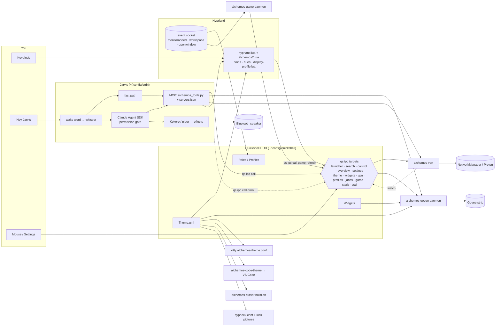

# AlchemOS

> *Solve et coagula.*

An alchemy-of-metals desktop for **Hyprland** on Arch / CachyOS: a holographic HUD of glowing, etched
sigils built with **Quickshell**, and a local voice assistant, **ORRIN** ☉ (with a second persona,
**SELENE** ☽), that runs everything through **Claude**. Every colour, screen, light and voice can be
changed, and every piece can be driven by every other one.

Alchemical-circle clock · six metal themes (☉ Aurum ☽ Argent ♂ Iron ♀ Verdigris ☿ Mercury ♄ Lead) ·
holographic workspace ring · radial app launcher · sealed-vault lock and shutdown animations ·
diagnostics wall · audio deck with visualizer · desktop widgets · Govee ambient lights · VPN switch ·
combat (gaming) mode · voice control.

> **Names in the code.** The repo, paths, scripts, services, settings keys and IPC targets keep their
> original names (`~/.alchemos`, `stark-*`, `~/.config/orrin`, `orrin.service`, the `jarvis`
> CLI and `jarvis*` keys), and the wake word is still **"hey Jarvis"**. Below, "Jarvis" means that
> code; on screen and in its voice the assistant is ORRIN / SELENE.

<!-- Screenshots: drop PNGs into .github/screenshots/ and uncomment.
| | |
| --- | --- |
|  |  |
|  |  |
|  |  |
|  |  |
-->
> 📸 *Screenshots coming soon: desk, alchemical-circle clock, launcher, overview, metal presets, the
> sealed vault, ORRIN.*

---

## Contents

- [Install](#install)
- [Keybinds](#keybinds)
- [Make it yours: customization](#make-it-yours-customization)
- [How the pieces talk: integration](#how-the-pieces-talk-integration)
- [Extend it](#extend-it)
- [The assistant (ORRIN · `jarvis`)](#the-assistant-orrin--jarvis)
- [Troubleshooting: config, lock screen, fingerprint, lid](#troubleshooting-config-lock-screen-fingerprint-lid)
- [Roadmap](#roadmap)

---

## Install

### 1. Packages

```
hyprland quickshell hyprlock hypridle cava kitty fuzzel brightnessctl playerctl jq
ttf-jetbrains-mono-nerd networkmanager bluez-utils uv librsvg hyprcursor python-pillow
```

Hyprland 0.56 or newer: the config is Lua (`~/.config/hypr/hyprland.lua`, see
[Hyprland config](#hyprland-config-lua)). hyprlock, hypridle and xdph still use their own `.conf` files.

The AlchemOS headings use **Cinzel** (SIL OFL, `~/.local/share/fonts/cinzel/`, in this repo with its
licence; run `fc-cache -f` after cloning) and the alchemical signs use `noto-fonts` (Noto Sans Symbols / Symbols 2).

Optional: `xorg-xcursorgen` (the cursor build falls back to its own `xcursorgen.py`), `protonvpn`
(for the Proton provider in alchemos-vpn), `gamemode`.

### 2. Clone the dotfiles (bare repo)

The config lives in a **bare git repo** at `~/.alchemos` with `$HOME` as its work tree, driven
through a `stark` command:

```fish
# fish (add the function to ~/.config/fish/config.fish to keep it)
function stark; git --git-dir=$HOME/.alchemos --work-tree=$HOME $argv; end
```
```sh
# bash / zsh
alias stark='git --git-dir=$HOME/.alchemos --work-tree=$HOME'
```

```sh
git clone --bare https://github.com/Tsheehan11/alchemos.git ~/.alchemos
stark config status.showUntrackedFiles no
stark checkout            # move any conflicting files out of the way first
```

Turn on the tracked git hooks (`~/.config/alchemos-hooks/`). The pre-commit hook refuses any commit that
stages `.config/orrin/` files unless every Jarvis test suite and the router eval pass
(`~/.config/orrin/tools/check_all.sh`, a few minutes; it needs the Jarvis venv from step 4):

```sh
stark config core.hooksPath "$HOME/.config/alchemos-hooks"
```

Then wire up the VS Code clean filter (tracked `settings.json` stays free of theme colours) and the
local excludes for files the HUD generates:

```sh
stark config filter.alchemos-code-theme.clean '$HOME/.local/bin/alchemos-code-settings-clean'
stark config filter.alchemos-code-theme.smudge cat
echo '.config/Code/User/settings.json filter=alchemos-code-theme' >> ~/.alchemos/info/attributes
printf '%s\n' .config/hypr/hyprlock.conf '.config/hypr/alchemos-lock-bg-*' .config/hypr/alchemos/display-profile.lua \
  .config/kitty/alchemos-theme.conf .config/govee/theme.json .config/quickshell/widgets.json \
  .config/orrin/.venv/ >> ~/.alchemos/info/exclude
```

Day to day: `stark status`, `stark add -p …`, `stark commit`, `stark push` (straight to `main`).

### 3. Your hardware

- **Monitors:** `hypr/alchemos/monitors.lua` matches the two desk monitors by model + serial (`leftMon`,
  `midMon`). Put your own `desc:` strings there (`hyprctl monitors` shows them). Screen *roles*
  are worked out by position, so port names don't matter.
- **Display profiles:** the desk is detected in `quickshell/ProfileLogic.js`. Change the dock /
  monitor IDs there, or just use **SAVE CURRENT AS THIS PROFILE** in Settings → DISPLAY.
- **Govee strip:** `alchemos-govee setup` finds the strip on the LAN and saves its IP;
  `alchemos-govee home` remembers your home network. Power hook: `fish ~/.config/govee/install.fish`.
- **Fingerprint / lock PAM:** `fish ~/.config/hypr/fprint-install.fish` (see
  [Troubleshooting](#troubleshooting-config-lock-screen-fingerprint-lid)).

### 4. Jarvis

```sh
cd ~/.config/orrin && uv venv --python 3.11
uv pip install --python .venv openwakeword faster-whisper claude-agent-sdk mcp piper-tts kokoro-onnx pedalboard
```

Put `kokoro-v1.0.int8.onnx` and `voices-v1.0.bin` (kokoro-onnx releases, `model-files-v1.0`) in
`~/.local/share/orrin/kokoro/`. Claude runs on your `claude` CLI login (Pro / Max), no API key.

Jarvis runs as a systemd user service, `~/.config/systemd/user/orrin.service` (tracked; no
`enable` needed, the HUD starts it through `~/.config/orrin/orrinctl`). After cloning:

```sh
ln -s ~/.config/orrin/orrinctl ~/.local/bin/orrinctl
systemctl --user daemon-reload
```

Log out and back in: Hyprland starts `qs`, `alchemos-govee daemon`, `alchemos-game daemon` and the audio
watcher; the HUD starts Jarvis (the service) when docked.

---

## Keybinds

| Keys | Action |
| --- | --- |
| `Super + Space` | Radial launcher (keys `1`–`9`, `0` launch the first ten; type to search) |
| `Super + R` | App search |
| `Super + Tab` | Workspace overview: hologram panels on a 3D ring, live previews |
| `Super + C` | Control center (Wi-Fi, Bluetooth, VPN, lights, ORRIN, combat mode…) |
| `Super + ,` | Settings |
| `Super + P` | Settings → DISPLAY |
| `Super + L` | Lock: the vault seals (its circle inscribes itself, the six signs light) |
| `Super + Escape` / power key | Power menu (shutdown plays a CRT power-off) |
| `Super + Return` | kitty |
| `Super + B` / `Super + E` | Zen browser / Dolphin |
| `Super + M` | Show / hide Spotify (relaunches it if closed) |
| `Super + D` | Peek: hide every window on this workspace to see the desktop; again to bring them back |
| `Super + Shift + R` | fuzzel (plain launcher) |
| `Super + Q` / `F` / `V` | Close / fullscreen / float window |
| `Super + ←↑→↓` | Move focus (`+ Shift`: move window) |
| `Super + 1…9` | Workspace (`+ Shift`: send window there) |
| `Super + drag` | Left: move window · right: resize |
| `Super + Shift + M` | Exit Hyprland |
| Media / volume / brightness keys | wpctl / playerctl / brightnessctl, with the HUD's pop-up |
| "Hey Jarvis…" | Everything else |

Docked, workspaces 1–3 live on the main monitor, 4–6 on the second and 7–9 on the laptop.

---

## Make it yours: customization

Nearly everything is a toggle in **Settings** (`Super + ,`). Every Settings value is saved in
`~/.config/quickshell/settings.json` (`Theme.qml` holds the full list with defaults), and any plain
value can also be set from a shell:

```sh
qs ipc call theme set panelOpacity 0.9
qs ipc call theme get orrinVoice
qs ipc call settings open appearance     # open a Settings tab
```

### Where each setting lives

| What | Settings tab | File / command |
| --- | --- | --- |
| Theme presets + custom presets | APPEARANCE | `settings.json` → `preset`, `primary`, `secondary`, `background`, `customPresets` |
| Panel opacity, effects frame rate, clock size | APPEARANCE | `panelOpacity`, `effectsFps`, `reactorScale` |
| Cursor size / opacity / animated busy cursor | APPEARANCE → CURSOR | `cursorSize`, `cursorOpacity`, `cursorAnimated` · `alchemos-cursor/build.sh` |
| Terminal glass (kitty transparency) | APPEARANCE | `terminalGlass` → `kitty/alchemos-theme.conf` |
| Govee mode + animation speed | APPEARANCE → AMBIENT LIGHTS | `govee/config.json` · `alchemos-govee mode / speed / level` |
| Which panels show on which screen | HUD | `showReactor`, `showDiag`, `showMedia`, `hideHudBehindWindows`, `osd` |
| Display layout + profiles | DISPLAY | `quickshell/display-profiles.json`, `ProfileLogic.js` |
| Audio outputs / inputs | AUDIO | PipeWire |
| Desktop widgets | WIDGETS | `quickshell/widgets.json` · `qs ipc call widgets …` |
| Jarvis voice, effect, model, speaker, mic | JARVIS | `jarvis*` keys · `jarvis/effects.json` |
| Radial launcher entries | LAUNCHER | `settings.json` → `launcherApps` |
| Idle dim / lock / screen-off / sleep | SYSTEM | `idleDim`, `idleLock`, `idleScreenOff`, `idleSleep` |
| Battery saver | SYSTEM | `autoSaver`, `batteryFps`, `saverNoBlur`, `saverLowRefresh`, `saverStopOrrin` |
| Combat mode | Control center | `game*` keys · `alchemos-game/games.conf` (extra game window classes) |
| VPN providers | NETWORK → VPN | `alchemos-vpn/providers.json` |

### Themes and custom presets

Six built-in metals, each with its alchemical sign on its tile: **☉ AURUM** (gold, the default),
**☽ ARGENT** (silver), **♂ IRON** (deep red), **♀ VERDIGRIS** (copper-teal), **☿ MERCURY** (cool cyan)
and **♄ LEAD** (violet-grey). Choosing one ignites it: its sign flares across the HUD and the Govee
strip wipes to the new colour. Pick primary and accent swatches to make a **CUSTOM** theme, then give it
a name to save it as a preset (up to 14 characters). Custom presets sit next to the built-ins, show
up in `qs ipc call theme presets`, and the assistant can apply them by name ("set the theme to Midnight").
The glyphs use Noto Sans Symbols / Symbols 2 (`noto-fonts`), which the HUD's mono font lacks.

One theme change ripples out to everything (see [the theme fan-out](#the-theme-fan-out)):
HUD, Hyprland borders, lock screen pictures, kitty, VS Code, cursor and the Govee strip.

### Cursor recolouring

`~/.config/alchemos-cursor/build.sh <rrggbb> [animated|static] [24|32|48] [20-90]` renders the SVG
templates in `src/` (`{{ACCENT}}`, `{{FILL_ALPHA}}`) into `~/.local/share/icons/ALCHEMOS`: an
XCursor theme in three sizes plus a hyprcursor theme, with a turning-sigil busy cursor.
`src/cursors.txt` lists every cursor's hotspot and aliases so nothing falls back to Adwaita. Builds
are cached per colour (about 1 s cold, 0.15 s cached).

`Theme.qml` rebuilds it 600 ms after the accent or a CURSOR setting changes. `build.sh` keeps
Hyprland's `env` lines, gsettings, GTK 3/4, xsettingsd, KDE and Xresources pointed at it, and
nudges GTK apps (Zen) to reload by briefly switching to an alias theme. XWayland apps (Steam,
Spotify) pick up a new colour on restart.

### kitty and VS Code theme sync

- **kitty:** the HUD writes `~/.config/kitty/alchemos-theme.conf` (16 ANSI colours tuned for contrast
  against the theme background, plus opacity from TERMINAL GLASS) and sends `SIGUSR1` to every kitty
  so open windows recolour live. `kitty.conf` just does `include alchemos-theme.conf`.
- **VS Code:** `alchemos-code-theme` merges `workbench.colorCustomizations` and the token colour keys
  into `~/.config/Code/User/settings.json` with `jq`, leaving every other setting alone. VS Code
  watches the file, so windows recolour without a reload. The terminal uses the same palette as
  kitty. The repo's clean filter (`alchemos-code-settings-clean`) strips those keys on commit.

### Radial launcher entries

Settings → LAUNCHER edits the ring: up to 16 apps (8 branches). Apps fill the ring in pairs: the
first of each pair sits by the core and carries the **branch** label (AI, NET, MEDIA…), the second
flows out from it. Each entry is:

```json
{ "id": "my-app", "name": "OBSIDIAN", "icon": "", "exec": "obsidian", "desktopId": "obsidian", "group": "NOTES" }
```

`desktopId` launches through the desktop entry (and borrows its icon); `exec` is a shell command
run through Hyprland (`~` works); `@control` and `@lock` are built-in actions. **RESET TO DEFAULTS**
reseeds from `LauncherApps.qml`.

### Per-monitor roles

`Roles.qml` gives each screen a job by position, never by port name:

| Setup | main | diag | media |
| --- | --- | --- | --- |
| Laptop only | laptop: clock, workspaces 1–5 | none | none |
| Docked | leftmost external: alchemical-circle clock, 1–3 | next external: diagnostics wall, 4–6 | laptop: audio deck, 7–9 |

Settings → HUD turns each panel on or off and hides panels on screens with open windows. Widgets
and Jarvis use the same role names ("show a clock on the second monitor"), so undocking moves
everything to the laptop and docking puts it back.

### Display profiles

What's plugged in picks a profile; each keeps its own arrangement, layout mode
(`extend | mirror | external | laptop`), Jarvis, Govee and battery saver settings:

| Profile | When | Gets |
| --- | --- | --- |
| HOME DESK | the dock and both desk monitors | extend, three roles, Jarvis on, strip on |
| LAPTOP ONLY | no external monitor | Jarvis off, strip off, battery saver |
| anything else | keyed by the monitors' descriptions (e.g. a TV) | starts as extend; keeps what you save |

Switching happens on Hyprland's `monitoradded` / `monitorremoved` (debounced 2.5 s) and after
resume. Settings → DISPLAY: **APPLY + KEEP**, **SAVE CURRENT AS THIS PROFILE**, **RESET PROFILE**.
`~/.config/hypr/alchemos/display-profile.lua` is generated from the active profile (a list of
`hl.monitor` specs that `alchemos/monitors.lua` applies last). Hyprland doesn't watch that file, so
only the HUD decides when to reload, through its 20 s reload-loop guard. From a shell:
`qs ipc call profiles status | recheck`.

### Hyprland config (Lua)

Hyprland 0.56 reads `~/.config/hypr/hyprland.lua`, which only loads the modules in
`~/.config/hypr/alchemos/`:

| Module | What's in it |
| --- | --- |
| `monitors.lua` | desk monitors by `desc:`, workspace homes (1–3 left, 4–6 middle, 7–9 laptop), then the HUD's `display-profile.lua` |
| `theme.lua` | cursor env (rewritten by `alchemos-cursor/build.sh`) and the start-up border / shadow / background colours |
| `looks.lua` | gaps, blur, shadows, animations, dwindle, input, misc (`anr_missed_pings`, lock restore) |
| `binds.lua` | every keybind |
| `rules.lua` | window rules (no app maximize, Spotify on `special:music`) and the doors' layer rule |
| `peek.lua` | Super + D: moves the workspace's windows to `special:peek<id>` and back. Those workspaces are the only state, so reloads and HUD restarts can't lose windows; `quickshell/Peek.qml` brings them back on lock, dock change, a new window there, and HUD start (`qs ipc call peek status`) |
| `autostart.lua` | `QT_QPA_PLATFORM` and what starts once at login (`hl.on("hyprland.start")`) |

**Edit the modules in place.** Saving one makes Hyprland reload by itself. Never ship or unpack a
`hyprland.lua` from a zip over this setup: it replaces the loader, and the HUD-written
`alchemos/display-profile.lua` and the module split go with it. New binds go in `binds.lua`
(`bind("D", peek.toggle)` is Peek, a Lua function from `peek.lua`). Scripts that add autostart lines append an
`hl.on("hyprland.start", …)` block to `autostart.lua` (see `govee/install.fish`).

Runtime changes are Lua too; `hyprctl keyword` and the old `dispatch exec …` syntax are gone:

```sh
hyprctl eval 'hl.config({ decoration = { blur = { enabled = false } } })'   # an option
hyprctl eval 'hl.monitor({ output = "eDP-1", mode = "1920x1200@48", position = "0x0", scale = 1 })'
hyprctl dispatch 'hl.dsp.exec_cmd("kitty")'                                   # = hl.dispatch(…)
hyprctl dispatch 'hl.dsp.focus({ workspace = 3 })'
hyprctl getoption decoration:blur:enabled                                     # unchanged
```

`hyprctl reload` still throws runtime changes away and sends `configreloaded`, which is when the
HUD re-pushes the theme, battery saver and the layout mode, and `alchemos-game` its combat settings.
In QML, `quickshell/Hypr.js` builds these strings (`Hypr.config`, `Hypr.monitors`, `Hypr.exec`, …);
`hypr/alchemos-dpms.sh on|off` turns screens on and off under either config format.

The Lua API stubs are in `/usr/share/hypr/stubs`; `hypr/.luarc.json` points the Lua language server
at them, so VS Code (with the `sumneko.lua` extension) completes `hl.*` in `~/.config/hypr`.

### Govee animations

`alchemos-govee` drives an H618C strip over the LAN, per segment (15 segments at up to 30 fps through
the DreamView "razer" stream):

- **Modes:** `auto` (theme colour, switching to a music spectrum from cava while audio plays),
  `music`, `theme`, `manual`, `off`. In combat mode music sync pauses (game audio isn't music): the
  strip eases to the theme glow and picks the music back up when the game ends.
- **Events:** boot, login, lock, unlock, logout, shutdown, sleep, wake, plus `alert` (a widget timer
  finished) and `listen` (Jarvis heard the wake word).
- **Tuning** in `govee/config.json`: `idle_level`, `music_floor`, `music_gain`, `gamma`,
  `white_balance`, `segment_fps`, `anim_speed`, `require_docked`, `silence_seconds`.
- **Colour overrides** for hues LEDs render badly: `alchemos-govee override "#ff5a4d" "#ff2000"`.
- Test an animation with `alchemos-govee anim unlock`; see the rest with `alchemos-govee` (no args).

### Jarvis voice presets and settings

Settings → JARVIS: Claude model (`auto` = Haiku, Sonnet when needed · or haiku / sonnet / opus),
voice (Kokoro `bm_*`, or a piper model; `orrin-voices` auditions them all), volume, speech rate,
pitch, voice effect, Bluetooth speaker, **INPUT DEVICE** (the wake-word mic: AUTO = a wired / USB
headset mic while one is plugged in, else the laptop mic; Bluetooth headset mics only if you allow
them, since they drop the headphones to call quality), follow-up window, spoken replies, music
ducking, pause in combat mode, plus **TEST VOICE** and **MISSED COMMANDS**.

Voice effects are presets in `~/.config/orrin/effects.json`, an effect chain run through pedalboard:

| Preset | Sound |
| --- | --- |
| `CLEAN` | Dry voice |
| `HOLOGRAM` | Warm, slight chorus and small-room reverb |
| `SUIT` | Band-limited helmet comms, a little drive |
| `AUTO` | SUIT on headphones, HOLOGRAM on speakers |

Add your own by copying a block in `effects.json` (keys: `highpass_hz`, `lowpass_hz`, `warmth_db`,
`presence_db`, `air_db`, `drive_db`, `compress`, `chorus_*`, `reverb_*`, `gain_db`, `speed`,
`pitch`); `_help` in the file explains each.

### Desktop widgets

Projected holograms on any screen, in one of nine slots: no solid cards, just corner brackets,
thin glowing strokes, a fill that fades out at the edges and faint scanlines (`HoloFrame.qml`).
They draw on when they appear and retract when closed; while effects run, a glint travels the edges,
the reticle's ticks turn and the odd micro-flicker passes over them, all from the shared Perf clock.
On battery saver, or wherever effects are paused, they stand still.

Types: clock (any time zone, analog or digital), timer (rings and flashes the lights), stopwatch,
now playing, system stats, sticky note, **agenda** (your main Google Calendar + the Outlook ICS
feed + SE tracker due dates, ◆ Google ◇ Outlook ▲ due, live countdowns), **due** (open tracker rows),
**jarvis** (listening / thinking / speaking, the request in hand, background tasks, the last command;
click for the console), **claude usage** (tokens today / this session, Haiku vs Sonnet; Pro plan
limits only when the Claude CLI itself reported them), **weather**, **network** (VPN, Wi-Fi,
throughput) and **dj deck** (now playing, the DJ set, its mood and next three, MORE / LESS / START). Drag to snap, ◇ to pin above windows, × to close, right-click the empty desktop to
make one. A new type is one QML file in `quickshell/widgets/`.

Data comes to them, never polled: Jarvis writes `$XDG_RUNTIME_DIR/orrin/status.json` when
something changes, and `jarvis feed` (only while an agenda / due / weather widget is up) writes
`~/.local/share/orrin/feed/{agenda,weather}.json`: calendars every 3 min, the tracker every 15,
weather every 30, and at once after Jarvis edits the calendar or tracker. No Claude calls.

---

## How the pieces talk: integration



### Quickshell IPC: the backbone

Everything goes through `qs ipc call <target> <function> [args]`, so keybinds, scripts and Jarvis
all use the same entry points (`quickshell/shell.qml`):

| Target | Functions | Used by |
| --- | --- | --- |
| `launcher` / `search` / `control` / `overview` | `toggle` | Hyprland binds |
| `settings` | `toggle`, `display`, `open <tab>` | binds, scripts |
| `theme` | `get <key>`, `set <key> <value>`, `presets`, `preset <name>` | Jarvis `set_theme`, scripts |
| `widgets` | `add`, `remove`, `move`, `pin`, `resize`, `clear`, `list`, `types` | Jarvis widget tools, scripts |
| `vpn` | `toggle`, `connect`, `disconnect`, `killswitch`, `status` | Jarvis `vpn`, control center |
| `profiles` | `status`, `recheck` | debugging |
| `stark` | `lock`, `locked`, `unlocked`, `power`, `menu` | `alchemos-lock.sh`, lid, power key |
| `game` | `refresh`, `toggle` | `alchemos-game` |
| `jarvis` | `online` (heartbeat; a restarted HUD answers `resync`), `restore`, `listening`, `transcript`, `thinking`, `tool`, `reply`, `confirm`, `toast`, `error`… | `jarvis/core/hud.py` → the Jarvis toast |
| `osd` | `brightness` | brightness keys |

```sh
qs ipc call widgets add clock diag top-right '{"tz":"America/New_York"}'
qs ipc call vpn toggle proton
qs ipc call theme preset iron          # the old names work too ("mark iii" → IRON)
```

### The theme fan-out

A change to `primary` / `secondary` in `Theme.qml` restarts short debounce timers that push the
palette to:

| Sink | How |
| --- | --- |
| Hyprland | `hyprctl eval 'hl.config({ … })'` for borders, shadows and background |
| Lock screen | rewrites `hypr/hyprlock.conf` from `hyprlock.template.conf` and redraws one picture per monitor (`alchemos-lock-bg-<NAME>.png`) |
| kitty | `kitty/alchemos-theme.conf` + `SIGUSR1` |
| VS Code | `alchemos-code-theme '<json>'` |
| Cursor | `alchemos-cursor/build.sh <hex> …` |
| Govee | `alchemos-govee theme <primary> <accent>` (with `strip_overrides` applied by the daemon) |

### The helper daemons

- **alchemos-govee** (`~/.config/govee/alchemos-govee.py`, started by Hyprland) owns the strip and
  listens on `$XDG_RUNTIME_DIR/alchemos-govee.sock`. The HUD (`Govee.qml`, via the CLI) sends modes, speed and
  lock / unlock events; widgets send `alert`; Jarvis sends `listen` and the `lights` tool's commands.
  `govee/system/alchemos-govee-power.service` (installed by `govee/install.fish`) covers shutdown.
- **alchemos-vpn** (`~/.config/alchemos-vpn/alchemos-vpn`) puts Proton VPN and NetworkManager VPNs (e.g.
  a school Cisco VPN) behind one CLI: `status | connect <id> | toggle <id> | disconnect |
  killswitch on|off | watch`. `VPN.qml` runs `watch` for live state; the control center tile, the
  bar, Settings → NETWORK and Jarvis all act through it. Only one provider is up at a time.
- **alchemos-game** watches Hyprland for game windows (`steam_app_*`, gamescope, and the regexes in
  `alchemos-game/games.conf`) and switches to **combat mode**: blur / animations off, performance power
  profile, HUD paused, COMBAT TELEMETRY on the other screens, Jarvis paused, do-not-disturb.
  Everything returns as it was when the last game closes.

### Jarvis ↔ everything

Jarvis never gets a shell. Claude sees only MCP tools: the local **stark** server
(`jarvis/mcp/alchemos_tools.py`, 26 typed tools, with the logic and validation in `alchemos_actions.py`)
plus whatever you add to `servers.json`. Those tools act through the same doors as you do:
`qs ipc call` for themes, widgets, VPN and lock; `hyprctl` for apps, windows and workspaces;
`alchemos-govee` for lights; `playerctl` / `wpctl` for media. Jarvis reports its own state back with
`qs ipc call orrin …`, which drives the on-screen toast.

The same server works in the Claude Code CLI too:

```sh
claude mcp add stark -- ~/.config/orrin/.venv/bin/python ~/.config/orrin/mcp/alchemos_tools.py
```

### Audio devices

"Switch audio to my headphones", "back to the speakers", "use my headset mic", "audio on the TV":
fast-path commands (`mcp/audio_devices.py`, also `jarvis audio list|output|input`) that move whatever
is playing with the output and ask "which one?" instead of guessing. "Speaker" means the Google Home
(connected on demand), "laptop" the built-in speakers / mic. A pick in Settings → AUDIO goes through
the same code. Your explicit choice wins over the Bluetooth-speaker rule below until a device is
plugged in or unplugged, and Jarvis confirms on the new output.

### Bluetooth speaker

Set **Speaker without headphones** in Settings → JARVIS (stored as a MAC in `orrinSpeaker`). When
the output isn't headphones, Jarvis connects the speaker as soon as it hears the wake word; if it
isn't up within 1.5 s, that reply plays on the laptop instead. Headphones, headsets and USB audio
always keep Jarvis on them.

### Spotify and DJ mode

Your own Spotify developer app (Development Mode: the app owner needs Premium) with PKCE sign-in, no
client secret: `jarvis spotify connect` (or Settings → JARVIS → SPOTIFY → CONNECT) walks you through
creating it. The redirect is `http://127.0.0.1:8898/callback`, open only while you sign in, because
Spotify refuses `localhost`. Tokens go to the system keyring (`jarvis:spotify`), refreshed on demand
under a lock (the voice loop, the MCP server and the CLI share them). `jarvis spotify status|devices|now|disconnect`.

- **Control** (`mcp/spotify_api.py`, stark tools `spotify_*`): play a track / album / artist / your
  playlist / Liked Songs by name, queue, like, shuffle, repeat, seek, Spotify's own volume, and move
  playback to a Connect device ("play Spotify on the Google Home"). "Next song", "pause" and the like stay
  on MPRIS. Without Premium, play / pause / skip fall back to MPRIS and Jarvis says the rest needs Premium.
  "Play it on the speaker" still means the Bluetooth audio route (above), not Spotify Connect.
- **DJ mode** (`core/dj.py`, in the voice process): *"DJ for me"*, *"play something for studying"*,
  *"put on some gym music"*. One Haiku call per set builds 20–30 tracks from your top tracks, recently
  played and liked songs (plus a few Spotify searches), ordered for genre, energy and era. Recommendations
  and audio-features aren't open to Development Mode apps, so Jarvis doesn't use them. Tracks are queued
  three ahead, nothing repeats within 48 h, and the set refills itself when it runs low. *"More / less like
  this"* reshapes the rest with one more call; *"keep this vibe"* holds it; *"save this vibe as late night"*
  makes a preset. Presets are in `jarvis/dj_moods.json`, your saved ones in `~/.local/share/orrin/dj/`. Put
  something else on and DJ mode bows out.
- **DJ chatter** (Settings → JARVIS → SPOTIFY, `orrinDjChatter`): off · **rare** (default, a line every
  4–5 tracks) · normal (every 2–3). Lines are under ten seconds, said as a track starts on the output
  Spotify plays on, with the music faded to 30 % and back. On a Connect device, Jarvis lowers that device's
  Spotify volume instead. Silent in combat mode and while Discord (or any call app) has the mic open.
- **Crossfade:** Spotify's API can't set it. Use Spotify → Settings → Playback → Crossfade songs
  (6–8 s suits DJ mode).
- **HUD:** MediaPanel shows DJ MODE, the set name and the next three; add the **dj deck** widget for
  the same on any screen.

---

## Extend it

### Add a Jarvis tool

1. Write the action in `jarvis/mcp/alchemos_actions.py`. Validate input (raise `Invalid`), return a
   dict, and run commands through `_do(...)` so `--dry-run` works:

   ```python
   def set_night_light(on):
       """Warm the screens for the evening."""
       return _do(f"night light {'on' if on else 'off'}",
                  ["hyprctl", "hyprsunset", "temperature", "4000" if on else "6500"])
   ```

2. Declare it in `jarvis/mcp/alchemos_tools.py`; the docstring is what Claude reads:

   ```python
   @mcp.tool(structured_output=False)
   def night_light(on: bool) -> str:
       """Turn the warm night-light filter on or off."""
       return out(A.set_night_light(on))
   ```

3. Optional: add a HUD label in `tool_label()` (`"NIGHT LIGHT → ON"`), a spoken "yes" in
   `confirmation_prompt()` if it's destructive, and a regex in `core/fastpath.py` so common phrasings
   skip Claude.
4. Try it without side effects: `jarvis --text "turn on the night light" --dry-run`.

### Add a launcher entry

Settings → LAUNCHER → add, or edit `launcherApps` in `settings.json` (see
[the entry format](#radial-launcher-entries)). To change the first-run defaults, edit `defaults()`
in `quickshell/LauncherApps.qml`.

### Add a theme preset

- **For you:** pick swatches in Settings → APPEARANCE and save with a name. Stored in
  `customPresets`: `[{ "name": "MIDNIGHT", "primary": "#7aa2ff", "secondary": "#ff9e64", "background": "#05060f" }]`.
- **Built in for everyone:** add a line (with its `glyph`) to `presets` in `quickshell/Skin.qml`. Jarvis picks it up
  automatically through `qs ipc call theme presets`.

### Add an MCP server (`servers.json`)

```json
"calendar": {
    "command": "{venv}/python",
    "args": ["-I", "{jarvis}/mcp/calendar_tools.py"],
    "auto_allow": ["list_events"]
}
```

`{venv}` and `{jarvis}` expand to the Jarvis venv and folder. Any server without `"policy": "alchemos"`
is gated: every tool needs a spoken "Shall I…, sir?" yes unless it's in `auto_allow`. Set
`"enabled": false` to park one. Secrets go in gnome-keyring through `core/secrets.py`, never in
this file.

### Add a widget type or game

- Widget: one QML file in `quickshell/widgets/` (copy `Stopwatch.qml`). `Widgets.qml` picks up
  every file there as a type; add it to the `widget_add` tool's `Literal` if Jarvis should make it.
- Game: a regex line in `~/.config/alchemos-game/games.conf` (`hyprctl clients | grep class`).

---

## The assistant (ORRIN · `jarvis`)

ORRIN ☉ answers by default and SELENE ☽ is the second persona: one assistant, two names, voices and
manners ("switch to Selene"). **"Hey Jarvis"** (openWakeWord) → faster-whisper `base.en` → a regex **fast path** for everyday
commands (media, lights, workspaces, VPN, themes, timers, weather: 5–40 ms, no AI) → otherwise
**Claude** through the Agent SDK: Haiku by default, Sonnet for longer or "explain / plan" requests.
Replies are spoken sentence by sentence as they stream. About 0.6–1 s from the end of your sentence
to his voice on the fast path, 2–3 s through Claude.

- **Rules enforced by Jarvis, not the model:** at most 8 tool calls per request, a 30 s timeout,
  the browser only when you ask for it, and a spoken yes before power actions, closing windows,
  deleting anything, the VPN kill switch, or sending a message. Tool output is data, never
  instructions. No network listeners. Runs with `NoNewPrivileges` (no sudo / setuid helpers).
- **Its own service:** `orrin.service` (systemd user unit), so restarting or hot-reloading
  Quickshell never stops it: a DJ set, a timer or a conversation carries on. The HUD
  (`quickshell/OrrinState.qml`) only starts and stops it, through `orrinctl start docked|laptop`
  / `stop`, keeping the rules: docked it follows the Jarvis toggle (`orrinDocked`, and battery saver
  if `saverStopOrrin`); undocked it's off until switched on for now, any dock / undock resets that;
  laptop mode stops under 20 % on battery; combat mode only pauses the wake word. A restarted HUD
  adopts whatever is running (a laptop-mode Jarvis stays on) and picks its state back up: the next
  heartbeat (`qs ipc call orrin online` → `resync`) makes Jarvis send `restore` (listening / thinking
  / confirm, combat pause), the app socket resends threads and the task in hand, and the widgets reread
  `status.json` (background tasks) and `dj.json` (DJ set). systemd restarts it after a crash
  (`Restart=on-failure`). It stops when you switch it off, at log-out (the power menu stops it, it's
  `PartOf=graphical-session.target`, and it exits by itself once its Hyprland instance is gone), and
  the stop takes its whole cgroup (claude CLI, MCP servers, `pw-record`). One voice loop at a time
  (a lock in `$XDG_RUNTIME_DIR/orrin/voice.lock`): a hand-run `jarvis` says it's already running.
  `orrinctl status|log|restart`, `journalctl --user -u orrin`, `alchemos-rescue status`.
- **Hearing:** `orrinMic` picks the PipeWire source (AUTO follows headsets; a plug / unplug or a
  Settings change restarts capture in place, without losing the pre-wake buffer); pre-roll keeps "hey Jarvis dim the lights"
  in one breath intact; Silero VAD ends the command; music ducks while listening. Barge in with
  "Hey Jarvis"; follow-ups need no wake word for 8 s.
- **Speech:** text is normalised first (`core/speech.py`: times, dates, units), the first sentence
  plays while the rest render, and stock lines are cached.
- **Memory:** "remember that…", reminders and facts live in `~/.local/share/orrin/orrin.db`.
- **CLI:** `jarvis --text "…" [--dry-run]`, `--misses`, `--log`, `--facts`, `--reminders`,
  `--say "…"`, `--trace` (wake score, VAD, transcript, route, latency), `--record [MIN]`.

Try: *"set the theme to Iron and dim the lights"*, *"timer for 10 minutes on the second
monitor"*, *"connect the VPN"*, *"what's playing"*, *"move the clock to the top right"*,
*"play Discovery by Daft Punk"*, *"DJ for me"*, *"like this song"*.

---

## Troubleshooting: config, lock screen, fingerprint, lid

**Hyprland config won't load?** A broken module shows Hyprland's red error bar naming the file and
line; the other modules still load (`hyprland.lua` loads each one on its own). Fix the file, save,
and Hyprland reloads by itself (`hyprctl configerrors` lists what's left). If nothing loaded at all,
Hyprland's emergency binds are active: `Super + Q` terminal, `Super + R` run, `Super + M` exit. To
get back to the old desktop instead, log out, log in on a TTY (Ctrl+Alt+F3) and run
`alchemos-rescue config`, which runs `start-hyprland -- --config ~/.config/hypr.conf-backup/hyprland.conf`
(the pre-Lua config, kept with its own `monitors.conf`). In that session the HUD's colour pushes and
window commands don't work (they speak Lua); it's for fixing `hyprland.lua`, not for daily use.

**Locked out?** From a TTY (Ctrl+Alt+F3) run `alchemos-rescue`. It clears faillock, thaws `user.slice`
if suspend left it frozen, turns the screens on, and unlocks hyprlock (or restarts a hung one under
`allow_session_lock_restore`). Back with Ctrl+Alt+F2.
`alchemos-rescue status` changes nothing: the Hyprland fix, the hotplug settle gate, and Jarvis's service
(running / failed, mode, crash restarts, any stray voice loop outside it).

**Fingerprint and faillock.** hyprlock takes the password or the fingerprint, whichever comes
first. The stock PAM stack recorded every fingerprint unlock as a failed password (the aborted
prompt), so three unlocks locked the account. `hypr/system/hyprlock.pam` ends an aborted prompt
without a faillock record; wrong passwords still count (`deny = 5`). Never kill or restart fprintd
under a running hyprlock: the suspend hooks only reset a wedged reader once no lock is up.

| Installed file | Source in this repo |
| --- | --- |
| `/etc/pam.d/hyprlock` | `hypr/system/hyprlock.pam` |
| `/etc/security/faillock.conf` (`deny = 5`) | edited in place by the installer |
| `/usr/lib/systemd/system-sleep/alchemos-fprintd` | `hypr/system/alchemos-fprintd-sleep` |
| `/usr/lib/systemd/system-sleep/alchemos-thaw` | `hypr/system/alchemos-thaw-sleep` |
| `/etc/systemd/logind.conf.d/alchemos.conf` | `hypr/system/logind-alchemos.conf` |

Install with `fish ~/.config/hypr/fprint-install.fish` (keeps `.orig` backups; run while unlocked).

**Lid.** Docked, closing the lid does nothing. Undocked, `hypr/lid.sh` shuts the doors, waits for
hyprlock, then turns the screen off; logind suspends and hypridle holds sleep until the lock is up.
While hyprlock opens the fingerprint reader (about half a second after it starts), `alchemos-lock.sh`
holds a `handle-lid-switch:sleep` block lock (3 s at most): a suspend that starts mid-open wedges the
Elan reader until a power-off, and logind suspends the moment the lock ends. If it wedges anyway:
`alchemos-fprint-reset` (the HUD says so).
Each monitor gets its own lock picture of the shut doors, so unlocking cuts seamlessly to the real
doors opening.

**Logs:** `journalctl -b | grep -E 'hyprlock|faillock'`, `~/.local/state/alchemos/hyprlock.log`,
`journalctl -u fprintd -b`, `journalctl --user -u orrin` (or `~/.local/share/orrin/orrin.log`), `alchemos-govee status`,
`alchemos-vpn status`.

---

## Roadmap

**Assistant phase 2: from desktop to house.** Each item is a new MCP server in `servers.json`; the core
loop doesn't change.

- [ ] **Calendar:** "what's on tomorrow", "move my 3 pm" (reads auto-allowed, writes confirmed)
- [ ] **Mail:** summaries and drafts; sending always needs a spoken yes
- [ ] **Smart home:** Nest thermostat, more lights, scenes tied to theme presets
- [ ] **Phone:** KDE Connect: notifications on the HUD, "find my phone", texts read aloud
- [ ] **Remote:** Tailscale, so Jarvis can check on the desk from the laptop
- [ ] **Hardware:** ESP32 sensors and a physical sigil status light
- [ ] Proactive briefings: morning summary on login, reminders spoken at the desk

Also on the list: screenshot gallery, a one-shot bootstrap script, per-profile theme presets.

---

<sub>Sounds in `quickshell/sounds/` are synthesized from scratch. Built with help from Claude.</sub>
