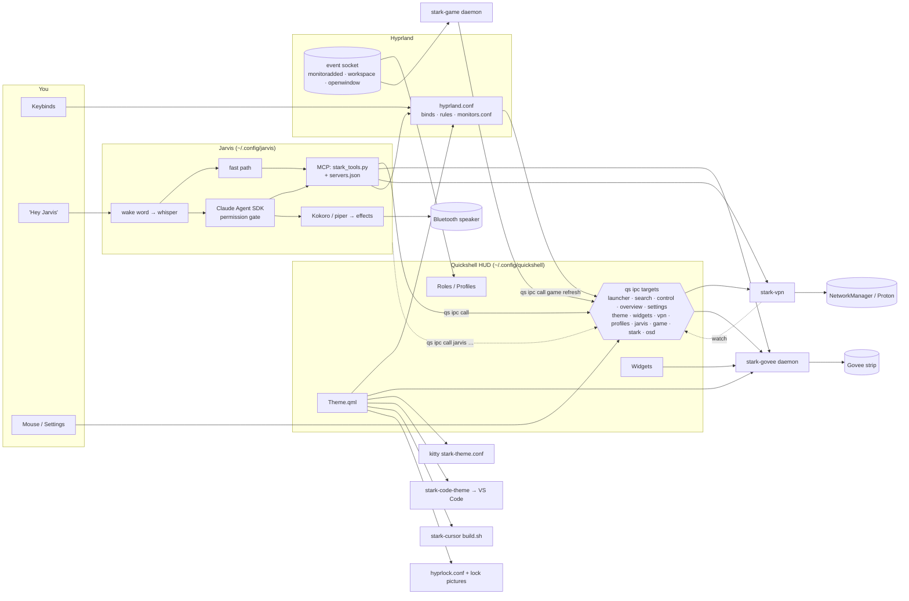

# STARK OS

> *"Sometimes you gotta run before you can walk."*

A holographic, Iron-Man-inspired desktop for **Hyprland** on Arch / CachyOS. The HUD is built with
**Quickshell**, and a local voice assistant, **Jarvis**, runs everything through **Claude**. Every
colour, screen, light and voice can be changed, and every piece can be driven by every other one.

Arc-reactor clock · holographic workspace ring · radial app launcher · security-door lock and
shutdown animations · diagnostics wall · audio deck with visualizer · desktop widgets · Govee
ambient lights · VPN switch · combat (gaming) mode · Jarvis voice control.

<!-- Screenshots: drop PNGs into .github/screenshots/ and uncomment.
| | |
| --- | --- |
|  |  |
|  |  |
|  |  |
-->
> 📸 *Screenshots coming soon: desk, launcher, overview, settings, security doors, Jarvis.*

---

## Contents

- [Suit-up (install)](#suit-up-install)
- [Keybinds](#keybinds)
- [Make it yours: customization](#make-it-yours-customization)
- [How the pieces talk: integration](#how-the-pieces-talk-integration)
- [Extend it](#extend-it)
- [Jarvis](#jarvis)
- [Troubleshooting: lock screen, fingerprint, lid](#troubleshooting-lock-screen-fingerprint-lid)
- [Roadmap](#roadmap)

---

## Suit-up (install)

### 1. Packages

```
hyprland quickshell hyprlock hypridle cava kitty fuzzel brightnessctl playerctl jq
ttf-jetbrains-mono-nerd networkmanager bluez-utils uv librsvg hyprcursor python-pillow
```

Optional: `xorg-xcursorgen` (the cursor build falls back to its own `xcursorgen.py`), `protonvpn`
(for the Proton provider in stark-vpn), `gamemode`.

### 2. Clone the dotfiles (bare repo)

The config lives in a **bare git repo** at `~/.stark-os` with `$HOME` as its work tree, driven
through a `stark` command:

```fish
# fish (add the function to ~/.config/fish/config.fish to keep it)
function stark; git --git-dir=$HOME/.stark-os --work-tree=$HOME $argv; end
```
```sh
# bash / zsh
alias stark='git --git-dir=$HOME/.stark-os --work-tree=$HOME'
```

```sh
git clone --bare https://github.com/Tsheehan11/stark-os.git ~/.stark-os
stark config status.showUntrackedFiles no
stark checkout            # move any conflicting files out of the way first
```

Then wire up the VS Code clean filter (tracked `settings.json` stays free of theme colours) and the
local excludes for files the HUD generates:

```sh
stark config filter.stark-code-theme.clean '$HOME/.local/bin/stark-code-settings-clean'
stark config filter.stark-code-theme.smudge cat
echo '.config/Code/User/settings.json filter=stark-code-theme' >> ~/.stark-os/info/attributes
printf '%s\n' .config/hypr/hyprlock.conf '.config/hypr/stark-lock-bg-*' .config/hypr/monitors.conf \
  .config/kitty/stark-theme.conf .config/govee/theme.json .config/quickshell/widgets.json \
  .config/jarvis/.venv/ >> ~/.stark-os/info/exclude
```

Day to day: `stark status`, `stark add -p …`, `stark commit`, `stark push` (straight to `main`).

### 3. Your hardware

- **Monitors:** `hyprland.conf` matches the two desk monitors by model + serial (`$leftMon`,
  `$midMon`). Put your own `desc:` strings there (`hyprctl monitors` shows them). Screen *roles*
  are worked out by position, so port names don't matter.
- **Display profiles:** the desk is detected in `quickshell/ProfileLogic.js`. Change the dock /
  monitor IDs there, or just use **SAVE CURRENT AS THIS PROFILE** in Settings → DISPLAY.
- **Govee strip:** `stark-govee setup` finds the strip on the LAN and saves its IP;
  `stark-govee home` remembers your home network. Power hook: `fish ~/.config/govee/install.fish`.
- **Fingerprint / lock PAM:** `fish ~/.config/hypr/fprint-install.fish` (see
  [Troubleshooting](#troubleshooting-lock-screen-fingerprint-lid)).

### 4. Jarvis

```sh
cd ~/.config/jarvis && uv venv --python 3.11
uv pip install --python .venv openwakeword faster-whisper claude-agent-sdk mcp piper-tts kokoro-onnx pedalboard
```

Put `kokoro-v1.0.int8.onnx` and `voices-v1.0.bin` (kokoro-onnx releases, `model-files-v1.0`) in
`~/.local/share/jarvis/kokoro/`. Claude runs on your `claude` CLI login (Pro / Max), no API key.

Log out and back in: Hyprland starts `qs`, `stark-govee daemon`, `stark-game daemon` and the audio
watcher; the HUD starts Jarvis when docked.

---

## Keybinds

| Keys | Action |
| --- | --- |
| `Super + Space` | Radial launcher (keys `1`–`9`, `0` launch the first ten; type to search) |
| `Super + R` | App search |
| `Super + Tab` | Workspace overview: hologram panels on a 3D ring, live previews |
| `Super + C` | Control center (Wi-Fi, Bluetooth, VPN, lights, Jarvis, combat mode…) |
| `Super + ,` | Settings |
| `Super + P` | Settings → DISPLAY |
| `Super + L` | Lock: security doors slam shut |
| `Super + Escape` / power key | Power menu (shutdown plays a CRT power-off) |
| `Super + Return` | kitty |
| `Super + B` / `Super + E` | Zen browser / Dolphin |
| `Super + M` | Show / hide Spotify (relaunches it if closed) |
| `Super + Shift + R` | fuzzel (plain launcher) |
| `Super + Q` / `F` / `V` | Close / fullscreen / float window |
| `Super + ←↑→↓` | Move focus (`+ Shift`: move window) |
| `Super + 1…9` | Workspace (`+ Shift`: send window there) |
| `Super + drag` | Left: move window · right: resize |
| `Super + Shift + M` | Exit Hyprland |
| Media / volume / brightness keys | wpctl / playerctl / brightnessctl, with the HUD's pop-up |
| "Hey Jarvis…" | Everything else |

Docked, workspaces 1–3 live on the main monitor, 4–6 on the second and 7–9 on the laptop.

---

## Make it yours: customization

Nearly everything is a toggle in **Settings** (`Super + ,`). Every Settings value is saved in
`~/.config/quickshell/settings.json` (`Theme.qml` holds the full list with defaults), and any plain
value can also be set from a shell:

```sh
qs ipc call theme set panelOpacity 0.9
qs ipc call theme get jarvisVoice
qs ipc call settings open appearance     # open a Settings tab
```

### Where each setting lives

| What | Settings tab | File / command |
| --- | --- | --- |
| Theme presets + custom presets | APPEARANCE | `settings.json` → `preset`, `primary`, `secondary`, `background`, `customPresets` |
| Panel opacity, effects frame rate, clock size | APPEARANCE | `panelOpacity`, `effectsFps`, `reactorScale` |
| Cursor size / opacity / animated busy cursor | APPEARANCE → CURSOR | `cursorSize`, `cursorOpacity`, `cursorAnimated` · `stark-cursor/build.sh` |
| Terminal glass (kitty transparency) | APPEARANCE | `terminalGlass` → `kitty/stark-theme.conf` |
| Govee mode + animation speed | APPEARANCE → AMBIENT LIGHTS | `govee/config.json` · `stark-govee mode / speed / level` |
| Which panels show on which screen | HUD | `showReactor`, `showDiag`, `showMedia`, `hideHudBehindWindows`, `osd` |
| Display layout + profiles | DISPLAY | `quickshell/display-profiles.json`, `ProfileLogic.js` |
| Audio outputs / inputs | AUDIO | PipeWire |
| Desktop widgets | WIDGETS | `quickshell/widgets.json` · `qs ipc call widgets …` |
| Jarvis voice, effect, model, speaker, mic | JARVIS | `jarvis*` keys · `jarvis/effects.json` |
| Radial launcher entries | LAUNCHER | `settings.json` → `launcherApps` |
| Idle dim / lock / screen-off / sleep | SYSTEM | `idleDim`, `idleLock`, `idleScreenOff`, `idleSleep` |
| Battery saver | SYSTEM | `autoSaver`, `batteryFps`, `saverNoBlur`, `saverLowRefresh`, `saverStopJarvis` |
| Combat mode | Control center | `game*` keys · `stark-game/games.conf` (extra game window classes) |
| VPN providers | NETWORK → VPN | `stark-vpn/providers.json` |

### Themes and custom presets

Six built-in suits: **STARK** (cyan / amber), **MARK III** (red / gold), **VIBRANIUM**, **MATRIX**,
**ARCTIC** and **SOLAR**. Pick primary and accent swatches to make a **CUSTOM** theme, then give it a
name to save it as a preset (up to 14 characters). Custom presets sit next to the built-ins, show up
in `qs ipc call theme presets`, and Jarvis can apply them by name ("set the theme to Midnight").

One theme change ripples out to everything (see [the theme fan-out](#the-theme-fan-out)):
HUD, Hyprland borders, lock screen pictures, kitty, VS Code, cursor and the Govee strip.

### Cursor recolouring

`~/.config/stark-cursor/build.sh <rrggbb> [animated|static] [24|32|48] [20-90]` renders the SVG
templates in `src/` (`{{ACCENT}}`, `{{FILL_ALPHA}}`) into `~/.local/share/icons/STARK-OS`: an
XCursor theme in three sizes plus a hyprcursor theme, with an arc-reactor busy cursor.
`src/cursors.txt` lists every cursor's hotspot and aliases so nothing falls back to Adwaita. Builds
are cached per colour (about 1 s cold, 0.15 s cached).

`Theme.qml` rebuilds it 600 ms after the accent or a CURSOR setting changes. `build.sh` keeps
Hyprland's `env` lines, gsettings, GTK 3/4, xsettingsd, KDE and Xresources pointed at it, and
nudges GTK apps (Zen) to reload by briefly switching to an alias theme. XWayland apps (Steam,
Spotify) pick up a new colour on restart.

### kitty and VS Code theme sync

- **kitty:** the HUD writes `~/.config/kitty/stark-theme.conf` (16 ANSI colours tuned for contrast
  against the theme background, plus opacity from TERMINAL GLASS) and sends `SIGUSR1` to every kitty
  so open windows recolour live. `kitty.conf` just does `include stark-theme.conf`.
- **VS Code:** `stark-code-theme` merges `workbench.colorCustomizations` and the token colour keys
  into `~/.config/Code/User/settings.json` with `jq`, leaving every other setting alone. VS Code
  watches the file, so windows recolour without a reload. The terminal uses the same palette as
  kitty. The repo's clean filter (`stark-code-settings-clean`) strips those keys on commit.

### Radial launcher entries

Settings → LAUNCHER edits the ring: up to 16 apps (8 branches). Apps fill the ring in pairs: the
first of each pair sits by the core and carries the **branch** label (AI, NET, MEDIA…), the second
flows out from it. Each entry is:

```json
{ "id": "my-app", "name": "OBSIDIAN", "icon": "", "exec": "obsidian", "desktopId": "obsidian", "group": "NOTES" }
```

`desktopId` launches through the desktop entry (and borrows its icon); `exec` is a shell command
run through Hyprland (`~` works); `@control` and `@lock` are built-in actions. **RESET TO DEFAULTS**
reseeds from `LauncherApps.qml`.

### Per-monitor roles

`Roles.qml` gives each screen a job by position, never by port name:

| Setup | main | diag | media |
| --- | --- | --- | --- |
| Laptop only | laptop: clock, workspaces 1–5 | none | none |
| Docked | leftmost external: arc-reactor clock, 1–3 | next external: diagnostics wall, 4–6 | laptop: audio deck, 7–9 |

Settings → HUD turns each panel on or off and hides panels on screens with open windows. Widgets
and Jarvis use the same role names ("show a clock on the second monitor"), so undocking moves
everything to the laptop and docking puts it back.

### Display profiles

What's plugged in picks a profile; each keeps its own arrangement, layout mode
(`extend | mirror | external | laptop`), Jarvis, Govee and battery saver settings:

| Profile | When | Gets |
| --- | --- | --- |
| HOME DESK | the dock and both desk monitors | extend, three roles, Jarvis on, strip on |
| LAPTOP ONLY | no external monitor | Jarvis off, strip off, battery saver |
| anything else | keyed by the monitors' descriptions (e.g. a TV) | starts as extend; keeps what you save |

Switching happens on Hyprland's `monitoradded` / `monitorremoved` (debounced 2.5 s) and after
resume. Settings → DISPLAY: **APPLY + KEEP**, **SAVE CURRENT AS THIS PROFILE**, **RESET PROFILE**.
`~/.config/hypr/monitors.conf` is generated from the active profile. From a shell:
`qs ipc call profiles status | recheck`.

### Govee animations

`stark-govee` drives an H618C strip over the LAN, per segment (15 segments at up to 30 fps through
the DreamView "razer" stream):

- **Modes:** `auto` (theme colour, switching to a music spectrum from cava while audio plays),
  `music`, `theme`, `manual`, `off`.
- **Events:** boot, login, lock, unlock, logout, shutdown, sleep, wake, plus `alert` (a widget timer
  finished) and `listen` (Jarvis heard the wake word).
- **Tuning** in `govee/config.json`: `idle_level`, `music_floor`, `music_gain`, `gamma`,
  `white_balance`, `segment_fps`, `anim_speed`, `require_docked`, `silence_seconds`.
- **Colour overrides** for hues LEDs render badly: `stark-govee override "#ff5a4d" "#ff2000"`.
- Test an animation with `stark-govee anim unlock`; see the rest with `stark-govee` (no args).

### Jarvis voice presets and settings

Settings → JARVIS: Claude model (`auto` = Haiku, Sonnet when needed · or haiku / sonnet / opus),
voice (Kokoro `bm_*`, or a piper model; `jarvis-voices` auditions them all), volume, speech rate,
pitch, voice effect, Bluetooth speaker, follow-up window, spoken replies, music ducking, pause in
combat mode, plus **TEST VOICE** and **MISSED COMMANDS**.

Voice effects are presets in `~/.config/jarvis/effects.json`, an effect chain run through pedalboard:

| Preset | Sound |
| --- | --- |
| `CLEAN` | Dry voice |
| `HOLOGRAM` | Warm, slight chorus and small-room reverb |
| `SUIT` | Band-limited helmet comms, a little drive |
| `AUTO` | SUIT on headphones, HOLOGRAM on speakers |

Add your own by copying a block in `effects.json` (keys: `highpass_hz`, `lowpass_hz`, `warmth_db`,
`presence_db`, `air_db`, `drive_db`, `compress`, `chorus_*`, `reverb_*`, `gain_db`, `speed`,
`pitch`); `_help` in the file explains each.

### Desktop widgets

Holographic cards on any screen, in one of nine slots: clock (any time zone, analog or digital),
timer (rings and flashes the lights), stopwatch, now playing, system stats, sticky note. Drag to
snap, ◇ to pin above windows, × to close, right-click the empty desktop to make one. A new type is
one QML file in `quickshell/widgets/`.

---

## How the pieces talk: integration



### Quickshell IPC: the backbone

Everything goes through `qs ipc call <target> <function> [args]`, so keybinds, scripts and Jarvis
all use the same entry points (`quickshell/shell.qml`):

| Target | Functions | Used by |
| --- | --- | --- |
| `launcher` / `search` / `control` / `overview` | `toggle` | Hyprland binds |
| `settings` | `toggle`, `display`, `open <tab>` | binds, scripts |
| `theme` | `get <key>`, `set <key> <value>`, `presets`, `preset <name>` | Jarvis `set_theme`, scripts |
| `widgets` | `add`, `remove`, `move`, `pin`, `resize`, `clear`, `list`, `types` | Jarvis widget tools, scripts |
| `vpn` | `toggle`, `connect`, `disconnect`, `killswitch`, `status` | Jarvis `vpn`, control center |
| `profiles` | `status`, `recheck` | debugging |
| `stark` | `lock`, `locked`, `unlocked`, `power`, `menu` | `stark-lock.sh`, lid, power key |
| `game` | `refresh`, `toggle` | `stark-game` |
| `jarvis` | `listening`, `transcript`, `thinking`, `tool`, `reply`, `confirm`, `toast`, `error`… | `jarvis/core/hud.py` → the Jarvis toast |
| `osd` | `brightness` | brightness keys |

```sh
qs ipc call widgets add clock diag top-right '{"tz":"America/New_York"}'
qs ipc call vpn toggle proton
qs ipc call theme preset "mark iii"
```

### The theme fan-out

A change to `primary` / `secondary` in `Theme.qml` restarts short debounce timers that push the
palette to:

| Sink | How |
| --- | --- |
| Hyprland | `hyprctl keyword` for borders and shadows |
| Lock screen | rewrites `hypr/hyprlock.conf` from `hyprlock.template.conf` and redraws one picture per monitor (`stark-lock-bg-<NAME>.png`) |
| kitty | `kitty/stark-theme.conf` + `SIGUSR1` |
| VS Code | `stark-code-theme '<json>'` |
| Cursor | `stark-cursor/build.sh <hex> …` |
| Govee | `stark-govee theme <primary> <accent>` (with `strip_overrides` applied by the daemon) |

### The helper daemons

- **stark-govee** (`~/.config/govee/stark-govee.py`, started by Hyprland) owns the strip and
  listens on `$XDG_RUNTIME_DIR/stark-govee.sock`. The HUD (`Govee.qml`, via the CLI) sends modes, speed and
  lock / unlock events; widgets send `alert`; Jarvis sends `listen` and the `lights` tool's commands.
  `govee/system/stark-govee-power.service` (installed by `govee/install.fish`) covers shutdown.
- **stark-vpn** (`~/.config/stark-vpn/stark-vpn`) puts Proton VPN and NetworkManager VPNs (e.g.
  a school Cisco VPN) behind one CLI: `status | connect <id> | toggle <id> | disconnect |
  killswitch on|off | watch`. `VPN.qml` runs `watch` for live state; the control center tile, the
  bar, Settings → NETWORK and Jarvis all act through it. Only one provider is up at a time.
- **stark-game** watches Hyprland for game windows (`steam_app_*`, gamescope, and the regexes in
  `stark-game/games.conf`) and switches to **combat mode**: blur / animations off, performance power
  profile, HUD paused, COMBAT TELEMETRY on the other screens, Jarvis paused, do-not-disturb.
  Everything returns as it was when the last game closes.

### Jarvis ↔ everything

Jarvis never gets a shell. Claude sees only MCP tools: the local **stark** server
(`jarvis/mcp/stark_tools.py`, 26 typed tools, with the logic and validation in `stark_actions.py`)
plus whatever you add to `servers.json`. Those tools act through the same doors as you do:
`qs ipc call` for themes, widgets, VPN and lock; `hyprctl` for apps, windows and workspaces;
`stark-govee` for lights; `playerctl` / `wpctl` for media. Jarvis reports its own state back with
`qs ipc call jarvis …`, which drives the on-screen toast.

The same server works in the Claude Code CLI too:

```sh
claude mcp add stark -- ~/.config/jarvis/.venv/bin/python ~/.config/jarvis/mcp/stark_tools.py
```

### Bluetooth speaker

Set **Speaker without headphones** in Settings → JARVIS (stored as a MAC in `jarvisSpeaker`). When
the output isn't headphones, Jarvis connects the speaker as soon as it hears the wake word; if it
isn't up within 1.5 s, that reply plays on the laptop instead. Headphones, headsets and USB audio
always keep Jarvis on them.

---

## Extend it

### Add a Jarvis tool

1. Write the action in `jarvis/mcp/stark_actions.py`. Validate input (raise `Invalid`), return a
   dict, and run commands through `_do(...)` so `--dry-run` works:

   ```python
   def set_night_light(on):
       """Warm the screens for the evening."""
       return _do(f"night light {'on' if on else 'off'}",
                  ["hyprctl", "hyprsunset", "temperature", "4000" if on else "6500"])
   ```

2. Declare it in `jarvis/mcp/stark_tools.py`; the docstring is what Claude reads:

   ```python
   @mcp.tool(structured_output=False)
   def night_light(on: bool) -> str:
       """Turn the warm night-light filter on or off."""
       return out(A.set_night_light(on))
   ```

3. Optional: add a HUD label in `tool_label()` (`"NIGHT LIGHT → ON"`), a spoken "yes" in
   `confirmation_prompt()` if it's destructive, and a regex in `core/fastpath.py` so common phrasings
   skip Claude.
4. Try it without side effects: `jarvis --text "turn on the night light" --dry-run`.

### Add a launcher entry

Settings → LAUNCHER → add, or edit `launcherApps` in `settings.json` (see
[the entry format](#radial-launcher-entries)). To change the first-run defaults, edit `defaults()`
in `quickshell/LauncherApps.qml`.

### Add a theme preset

- **For you:** pick swatches in Settings → APPEARANCE and save with a name. Stored in
  `customPresets`: `[{ "name": "MIDNIGHT", "primary": "#7aa2ff", "secondary": "#ff9e64", "background": "#05060f" }]`.
- **Built in for everyone:** add a line to `presets` in `quickshell/Theme.qml`. Jarvis picks it up
  automatically through `qs ipc call theme presets`.

### Add an MCP server (`servers.json`)

```json
"calendar": {
    "command": "{venv}/python",
    "args": ["-I", "{jarvis}/mcp/calendar_tools.py"],
    "auto_allow": ["list_events"]
}
```

`{venv}` and `{jarvis}` expand to the Jarvis venv and folder. Any server without `"policy": "stark"`
is gated: every tool needs a spoken "Shall I…, sir?" yes unless it's in `auto_allow`. Set
`"enabled": false` to park one. Secrets go in gnome-keyring through `core/secrets.py`, never in
this file.

### Add a widget type or game

- Widget: one QML file in `quickshell/widgets/` (copy `Stopwatch.qml`). `Widgets.qml` picks up
  every file there as a type; add it to the `widget_add` tool's `Literal` if Jarvis should make it.
- Game: a regex line in `~/.config/stark-game/games.conf` (`hyprctl clients | grep class`).

---

## Jarvis

**"Hey Jarvis"** (openWakeWord) → faster-whisper `base.en` → a regex **fast path** for everyday
commands (media, lights, workspaces, VPN, themes, timers, weather: 5–40 ms, no AI) → otherwise
**Claude** through the Agent SDK: Haiku by default, Sonnet for longer or "explain / plan" requests.
Replies are spoken sentence by sentence as they stream. About 0.6–1 s from the end of your sentence
to his voice on the fast path, 2–3 s through Claude.

- **Rules enforced by Jarvis, not the model:** at most 8 tool calls per request, a 30 s timeout,
  the browser only when you ask for it, and a spoken yes before power actions, closing windows,
  deleting anything, the VPN kill switch, or sending a message. Tool output is data, never
  instructions. No network listeners. Started by the HUD under `setpriv --no-new-privs`.
- **Hearing:** `jarvisMic` picks the PipeWire source; pre-roll keeps "hey Jarvis dim the lights"
  in one breath intact; Silero VAD ends the command; music ducks while listening. Barge in with
  "Hey Jarvis"; follow-ups need no wake word for 8 s.
- **Speech:** text is normalised first (`core/speech.py`: times, dates, units), the first sentence
  plays while the rest render, and stock lines are cached.
- **Memory:** "remember that…", reminders and facts live in `~/.local/share/jarvis/jarvis.db`.
- **CLI:** `jarvis --text "…" [--dry-run]`, `--misses`, `--log`, `--facts`, `--reminders`,
  `--say "…"`, `--trace` (wake score, VAD, transcript, route, latency), `--record [MIN]`.

Try: *"set the theme to Mark III and dim the lights"*, *"timer for 10 minutes on the second
monitor"*, *"connect the VPN"*, *"what's playing"*, *"move the clock to the top right"*.

---

## Troubleshooting: lock screen, fingerprint, lid

**Locked out?** From a TTY (Ctrl+Alt+F3) run `stark-rescue`. It clears faillock, thaws `user.slice`
if suspend left it frozen, turns the screens on, and unlocks hyprlock (or restarts a hung one under
`allow_session_lock_restore`). Back with Ctrl+Alt+F2.

**Fingerprint and faillock.** hyprlock takes the password or the fingerprint, whichever comes
first. The stock PAM stack recorded every fingerprint unlock as a failed password (the aborted
prompt), so three unlocks locked the account. `hypr/system/hyprlock.pam` ends an aborted prompt
without a faillock record; wrong passwords still count (`deny = 5`). Never kill or restart fprintd
under a running hyprlock: the suspend hooks only reset a wedged reader once no lock is up.

| Installed file | Source in this repo |
| --- | --- |
| `/etc/pam.d/hyprlock` | `hypr/system/hyprlock.pam` |
| `/etc/security/faillock.conf` (`deny = 5`) | edited in place by the installer |
| `/usr/lib/systemd/system-sleep/stark-fprintd` | `hypr/system/stark-fprintd-sleep` |
| `/usr/lib/systemd/system-sleep/stark-thaw` | `hypr/system/stark-thaw-sleep` |
| `/etc/systemd/logind.conf.d/stark.conf` | `hypr/system/logind-stark.conf` |

Install with `fish ~/.config/hypr/fprint-install.fish` (keeps `.orig` backups; run while unlocked).

**Lid.** Docked, closing the lid does nothing. Undocked, `hypr/lid.sh` shuts the doors, waits for
hyprlock, then turns the screen off; logind suspends and hypridle holds sleep until the lock is up.
Each monitor gets its own lock picture of the shut doors, so unlocking cuts seamlessly to the real
doors opening.

**Logs:** `journalctl -b | grep -E 'hyprlock|faillock'`, `~/.local/state/stark/hyprlock.log`,
`journalctl -u fprintd -b`, `~/.local/share/jarvis/jarvis.log`, `stark-govee status`,
`stark-vpn status`.

---

## Roadmap

**Jarvis phase 2: from desktop to house.** Each item is a new MCP server in `servers.json`; the core
loop doesn't change.

- [ ] **Calendar:** "what's on tomorrow", "move my 3 pm" (reads auto-allowed, writes confirmed)
- [ ] **Mail:** summaries and drafts; sending always needs a spoken yes
- [ ] **Smart home:** Nest thermostat, more lights, scenes tied to theme presets
- [ ] **Phone:** KDE Connect: notifications on the HUD, "find my phone", texts read aloud
- [ ] **Remote:** Tailscale, so Jarvis can check on the desk from the laptop
- [ ] **Hardware:** ESP32 sensors and a physical arc-reactor status light
- [ ] Proactive briefings: morning summary on login, reminders spoken at the desk

Also on the list: screenshot gallery, a one-shot bootstrap script, per-profile theme presets.

---

<sub>Sounds in `quickshell/sounds/` are synthesized from scratch. Not affiliated with Marvel. Built
with help from Claude.</sub>
